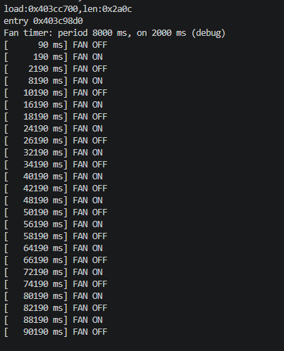

# Beetroot Academy — Embedded Development (ESP32-S3)

PlatformIO-проєкт для ESP32-S3 DevKitC-1 (Arduino framework).
У `src/` — поточне завдання, попередні — в `homework/`.

## Поточне ДЗ 2.5: Таймери — витяжний вентилятор

Вентилятор вмикається кожну годину на 15 хвилин і сам вимикається.

- Цикл повністю веде **апаратний таймер** (`timerBegin` / `timerAlarmWrite`): переривання кожні 100 мс рахує тіки
  і саме вмикає/вимикає вентилятор. `loop()` вентилятором не керує — лише пише лог і скидає watchdog.
- Без `delay()`. Період і час роботи задаються макросами `FAN_PERIOD_MS` і `FAN_ON_MS`.
- `DEBUG_MODE 1`: «година» = 8 с, «15 хвилин» = 2 с (та сама пропорція 1/4). `DEBUG_MODE 0` — реальні 1 год / 15 хв.

Опційно:
- **Watchdog** (`esp_task_wdt`): якщо `loop()` зависне на 5 с — перезавантаження;
- **Логування станів**: кожне ввімкнення/вимкнення з часом у Serial Monitor;
- **Захист від повторного запуску**: таймер не вмикає вентилятор, якщо той ще працює, плюс `static_assert`, що час роботи менший за період;
- **LED-індикатори**: зелений — вентилятор працює, червоний — вимкнений.

### Схема
| Елемент | Підключення |
|---|---|
| Вентилятор (модуль реле) | GPIO17 → 220 Ом → база 2N2222 (10 кОм база → GND); колектор → IN реле; емітер → GND; реле VCC/GND від плати живлення 5 В |
| LED «працює» | GPIO4 → 220 Ом → зелений LED → GND |
| LED «вимкнений» | GPIO5 → 220 Ом → червоний LED → GND |

### Результат (Serial Monitor, DEBUG_MODE 1)
```
Fan timer: period 8000 ms, on 2000 ms (debug)
[      90 ms] FAN OFF
[     190 ms] FAN ON
[    2190 ms] FAN OFF
[    8190 ms] FAN ON
[   10190 ms] FAN OFF
[   16190 ms] FAN ON
[   18190 ms] FAN OFF
[   24190 ms] FAN ON
[   26190 ms] FAN OFF
...
[   88190 ms] FAN ON
[   90190 ms] FAN OFF
```


### Висновки
- Вентилятор вмикається рівно кожні **8000 мс** і працює рівно **2000 мс** — без дрейфу за 90 с роботи (11 циклів).
  Так само працюватиме реальний режим: 1 година / 15 хвилин (`DEBUG_MODE 0`).
- Цикл веде апаратний таймер у перериванні, тому він не залежить від того, що робить `loop()`.
- LED-індикатори і реле перемикаються одночасно з логом.

## Попередні завдання (`homework/`)
- `debounce/` — ДЗ 2.4: 4 методи debounce + RC-фільтр, порівняльна таблиця;
- `superloop/` — ДЗ 2.3: три незалежні LED (200 / 500 / 1000 мс) у superloop на `millis()`;
- `relay/` — вимірювання часу спрацювання реле (`micros()` + переривання), результати 10 вимірювань;
- `motor_control/` — код з уроку: PWM-керування DC-мотором через транзистор, команди off / low / mid / high з Serial;
- `embedded_blink/` — Blink в стилі Embedded C++: `enum class`, `static constexpr`, кнопка через переривання, час `loop()`;
- `headlight_hazard/` — Варіант 2: адаптивна фара (LDR) + аварійна сигналізація, схема та симуляція Wokwi;
- `1.5_bounce.cpp` — дослідження брязкоту кнопки через переривання;
- `1.6_ldr_alt.cpp` — LDR, АЦП і похибка `analogRead()` vs `analogReadMilliVolts()`;
- `police_flasher.cpp` — поліцейська мигалка.
