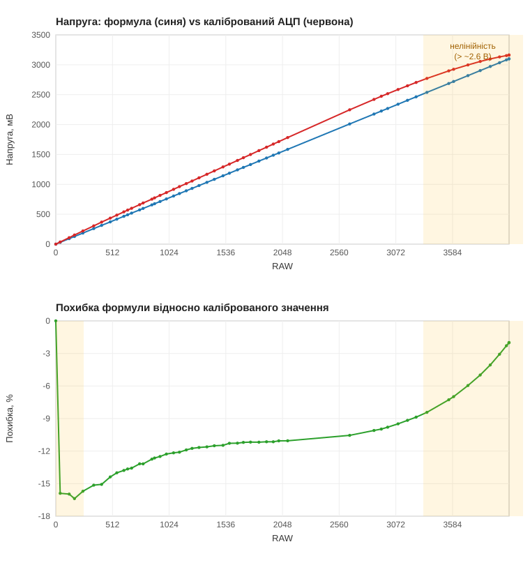

# Beetroot Academy — Embedded Development (ESP32-S3)

PlatformIO-проєкт для ESP32-S3 DevKitC-1.
У `src/` — поточне завдання, попередні — в `homework/`.

## Поточне ДЗ 3.2: Калібрування даних з ADC — ESP-IDF

Потенціометр ~10 кОм як подільник напруги на ADC1 ([src/main.c](src/main.c)). Кожні 100 мс:
1. `adc_oneshot_read` — сире значення **RAW**;
2. **U_manual** — напруга за формулою `U = RAW · Vref / 4095`;
3. **U_cali** — напруга через калібрований АЦП (`adc_cali`, схема curve fitting, заводські дані з eFuse);
4. **Error(%)** = (U_manual − U_cali) / U_cali · 100.

| Параметр | Значення |
|---|---|
| Опорна напруга (для формули) | 3100 мВ — повна шкала при атенюації 12 дБ |
| Атенюація | 12 дБ (вхід ~0…3.1 В) |
| Розрядність | 12 біт (RAW 0…4095) |
| Період вимірювань | 100 мс |

### Схема
| Елемент | Підключення |
|---|---|
| Потенціометр, крайня ніжка 1 | 3V3 |
| Потенціометр, середня ніжка (повзунок) | GPIO2 (ADC1_CH1) |
| Потенціометр, крайня ніжка 2 | GND |

### Результат (Serial Monitor)
Ручку потенціометра прокручено від упору до упору. Вибрані рядки:
```
RAW   U_manual(mV)  U_cali(mV)  Error(%)
------------------------------------------
   0         0.0           0      0.00
  40        30.3          36    -15.89
 169       127.9         153    -16.38
 492       372.5         435    -14.38
1064       805.5         917    -12.16
1511      1143.9        1292    -11.47
2095      1586.0        1783    -11.05
2655      2009.9        2247    -10.55
3092      2340.7        2586     -9.49
3550      2687.4        2898     -7.27
3834      2902.4        3055     -4.99
4009      3034.9        3131     -3.07
4095      3100.0        3163     -1.99
```
Повні логи: [1](docs/log_1.png), [2](docs/log_2.png), [3](docs/log_3.png), [4](docs/log_4.png), [5](docs/log_5.png).

### Графік (опційно)


### Висновки
- **Формула занижує напругу на 2–16 %.** Вона припускає, що вся шкала 4095 = 3100 мВ і що залежність лінійна.
  Насправді в середині діапазону 1 одиниця RAW ≈ 0.85 мВ (а не 0.76 мВ, як у формулі), плюс у кожного чипа свій заводський розкид — калібрування ESP-IDF це враховує.
- **Похибка не постійна** — тобто АЦП нелінійний. Ділянки нелінійності (на графіку виділені):
  - **біля нуля** (RAW < ~250): похибка найбільша, до −16 %; при малих напругах АЦП ще й деякий час показує 0;
  - **верх шкали** (вище ~2.6 В, RAW > ~3300): калібрована крива «загинається» — на ділянці RAW 3550→4095 напруга зростає лише на 265 мВ (≈ 0.49 мВ/одиницю проти ≈ 0.85 в середині);
  - **насичення**: RAW = 4095 вже при ~3.16 В, хоча на потенціометрі до 3.3 В — більшу напругу АЦП при атенюації 12 дБ не розрізняє.
- **Висновок:** для точних вимірювань напруги на ESP32 треба використовувати калібрований АЦП (`adc_cali`), а не формулу; робочий діапазон варто тримати приблизно 0.15…2.6 В.
## Попередні завдання (`homework/`)
- `sma/` — ДЗ 3.1: SMA-фільтр для LDR на ESP-IDF, гістерезис;
- `miniproject_automotive/` — міні-проєкт (модуль 2, урок 7): замок, аварійка, поворотники, датчик удару; DL → CL → BL;
- `debounce_idf/` — ДЗ 2.6: debounce на ESP-IDF, state-based на апаратному таймері `gptimer`;
- `timers/` — ДЗ 2.5: апаратний таймер керує витяжним вентилятором (реле), watchdog, лог, LED;
- `debounce/` — ДЗ 2.4: 4 методи debounce + RC-фільтр, порівняльна таблиця;
- `superloop/` — ДЗ 2.3: три незалежні LED (200 / 500 / 1000 мс) у superloop на `millis()`;
- `relay/` — вимірювання часу спрацювання реле (`micros()` + переривання), результати 10 вимірювань;
- `motor_control/` — код з уроку: PWM-керування DC-мотором через транзистор, команди off / low / mid / high з Serial;
- `embedded_blink/` — Blink в стилі Embedded C++: `enum class`, `static constexpr`, кнопка через переривання, час `loop()`;
- `headlight_hazard/` — Варіант 2: адаптивна фара (LDR) + аварійна сигналізація, схема та симуляція Wokwi;
- `1.5_bounce.cpp` — дослідження брязкоту кнопки через переривання;
- `1.6_ldr_alt.cpp` — LDR, АЦП і похибка `analogRead()` vs `analogReadMilliVolts()`;
- `police_flasher.cpp` — поліцейська мигалка.
