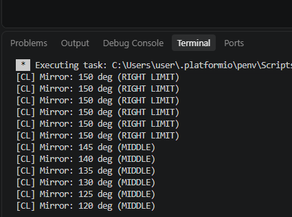
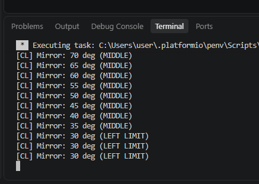

# Beetroot Academy — Embedded Development (ESP32-S3)

PlatformIO-проєкт для ESP32-S3 DevKitC-1 (Arduino framework).
У `src/` + `include/` — поточне завдання, попередні — в `homework/`.

## Поточне: міні-проєкт Automotive (модулі 2 + 3)

### Модуль 2
| Кнопка | Коротке натискання | Довге (2000 мс) | Подвійний клік |
|---|---|---|---|
| Замок (реле) | відкрити / закрити | валет-режим: замок відкривається, аварійне блокування знімається (повторне довге — вихід) | — |
| Аварійка (BOOT) | увімк / вимк | — | — |
| Поворотник | лівий увімк / вимк | — | правий увімк / вимк |
| Датчик удару | пригальмовування: червоний LED на 1 с | аварія: двері відкриваються, аварійка, двигун глушиться; знімається лише валет-режимом | — |

### Модуль 3
| Функція | Як працює |
|---|---|
| Автоматичні фари | LDR → ADC кожні 20 мс → фільтр **SMA** (16) → **гістерезис** (темно < 1500, світло > 1900) → білий LED |
| Бокове дзеркало | енкодер KY-040 → серво: один клік = 5°, межі 30…150°; кнопка енкодера — дзеркало в центр (90°) |
| Швидкість двигуна | потенціометр → ADC кожні 20 мс → фільтр **SMA** → 0…100 % → ШІМ 20 кГц; мертва зона < 5 %, старт з 39 % заповнення |

### Вимоги і як виконано
1. **Без блокуючого коду** — жодного `delay()`; усі інтервали — таймери `esp_timer`.
2. **Без polling** — кнопки й енкодер на перериваннях; аналогові датчики вимірюються за таймером (подія `AdcTick`).
   `loop()` спить на черзі подій FreeRTOS і прокидається лише на подію.
3. **Антидребезг** — кнопки: таймер 30 мс після останнього фронту; енкодер: таблиця квадратурних переходів
   (брязкіт дає неможливі або «туди-назад» переходи, які взаємно знищуються).
4. Блимання поворотників **500 мс**, 5. довге натискання **2000 мс** — у [include/config.h](include/config.h).
6. **Кожен компонент окремо зі своєю машиною станів, шари DL → CL → BL:**

| Шар | Компонент | Стани |
|---|---|---|
| DL | `Button` — переривання + антидребезг | Released / Pressed |
| DL | `Encoder` — квадратурний декодер у перериванні | крок +1 / −1 |
| DL | `Output`, `PwmOutput` (LEDC), `Servo` (50 Гц) | — |
| CL | `ClickDetector` — короткий / довгий / подвійний клік | Idle / Pressed / LongHeld / WaitSecond / SecondPressed |
| CL | `Blinker` — поворотники та аварійка | Off / Left / Right / Hazard |
| CL | `Lock` — замок на реле | Locked / Unlocked |
| CL | `BrakeLight` — стоп-сигнал | Off / On |
| CL | `LightSensor` — LDR + SMA + гістерезис | Light / Dark |
| CL | `Throttle` — потенціометр + SMA | 0…100 % |
| CL | `Headlight` — фари | Off / On |
| CL | `Motor` — двигун | Stopped / Running |
| CL | `Mirror` — дзеркало на серво | LeftLimit / Middle / RightLimit |
| BL | `Car` | Normal / Valet / Crash |

7. **Фільтри для аналогового сигналу** — `Sma` (ковзна середня) для LDR і потенціометра, плюс гістерезис для фар.

### Схема
| Елемент | Підключення |
|---|---|
| Кнопка «замок» | GPIO7 ↔ кнопка ↔ GND |
| Кнопка «аварійка» | вбудована кнопка BOOT (GPIO0) |
| Кнопка «поворотник» | GPIO16 ↔ кнопка ↔ GND |
| Датчик удару | GPIO18 → провід-контакт; торкання GND = спрацювання |
| Лівий / правий поворотник | GPIO4 / GPIO5 → 220 Ом → жовтий LED → GND |
| Стоп-сигнал | GPIO6 → 220 Ом → червоний LED → GND |
| Фари | GPIO15 → 220 Ом → білий LED → GND |
| Замок (реле) | GPIO17 → 220 Ом → база 2N2222 №1 (10 кОм база → GND); колектор → IN реле; емітер → GND; реле VCC/GND — 5 В плати живлення |
| Двигун | GPIO14 → 220 Ом → база 2N2222 №2 (10 кОм база → GND); колектор → (−) двигуна; (+) двигуна → 5 В; діод паралельно двигуну смужкою до +; 100 мкФ між 5 В і GND |
| Серво | сигнал → GPIO10, червоний → 5 В плати живлення, коричневий → GND |
| Енкодер KY-040 | CLK → GPIO11, DT → GPIO12, SW → GPIO13, + → **3V3** ESP, GND → GND |
| LDR | 3V3 → LDR → GPIO2 → 10 кОм → GND |
| Потенціометр | крайні ніжки — 3V3 і GND, повзунок — GPIO1 |

GND плати живлення з'єднаний з GND ESP.

### Результат
Зібрано і перевірено на платі поетапно: поворотники й аварійка, кнопки і датчик удару, реле замка,
двигун з потенціометром, автоматичні фари, енкодер і серво-дзеркало — усе працює.

Енкодер: кожен клік — рівно 5°, межі 30° і 150° утримуються:
```
[CL] Mirror: 150 deg (RIGHT LIMIT)
[CL] Mirror: 145 deg (MIDDLE)
[CL] Mirror: 140 deg (MIDDLE)
...
[CL] Mirror: 35 deg (MIDDLE)
[CL] Mirror: 30 deg (LEFT LIMIT)
[CL] Mirror: 30 deg (LEFT LIMIT)
```
 

Фари, замок і двигун:
```
[BL] lock: short
[CL] Lock: LOCKED
[CL] Light sensor: DARK (SMA 1496)
[CL] Headlight: ON
[CL] Motor: RUNNING
[CL] Light sensor: LIGHT (SMA 1905)
[CL] Headlight: OFF
[CL] Motor: STOPPED
```
## Попередні завдання (`homework/`)
- `buzzer/` — ДЗ 3.4: неблокуючий плеєр для зумера (LEDC, тік 50 мс) — ESP-IDF;
- `pwm/` — ДЗ 3.3: потенціометр керує яскравістю LED і швидкістю двигуна (LEDC);
- `adc_calibration/` — ДЗ 3.2: калібрування ADC, похибка формули, графік нелінійності;
- `sma/` — ДЗ 3.1: SMA-фільтр для LDR на ESP-IDF, гістерезис;
- `miniproject_automotive/` — міні-проєкт (модуль 2, урок 7): замок, аварійка, поворотники, датчик удару; DL → CL → BL;
- `debounce_idf/` — ДЗ 2.6: debounce на ESP-IDF, state-based на апаратному таймері `gptimer`;
- `timers/` — ДЗ 2.5: апаратний таймер керує витяжним вентилятором (реле), watchdog, лог, LED;
- `debounce/` — ДЗ 2.4: 4 методи debounce + RC-фільтр, порівняльна таблиця;
- `superloop/` — ДЗ 2.3: три незалежні LED (200 / 500 / 1000 мс) у superloop на `millis()`;
- `relay/` — вимірювання часу спрацювання реле (`micros()` + переривання), результати 10 вимірювань;
- `motor_control/` — код з уроку: PWM-керування DC-мотором через транзистор, команди off / low / mid / high з Serial;
- `embedded_blink/` — Blink в стилі Embedded C++: `enum class`, `static constexpr`, кнопка через переривання, час `loop()`;
- `headlight_hazard/` — Варіант 2: адаптивна фара (LDR) + аварійна сигналізація, схема та симуляція Wokwi;
- `1.5_bounce.cpp` — дослідження брязкоту кнопки через переривання;
- `1.6_ldr_alt.cpp` — LDR, АЦП і похибка `analogRead()` vs `analogReadMilliVolts()`;
- `police_flasher.cpp` — поліцейська мигалка.
