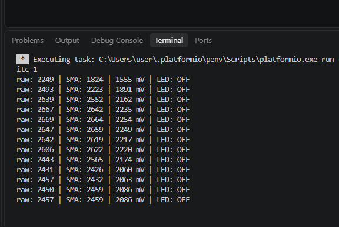
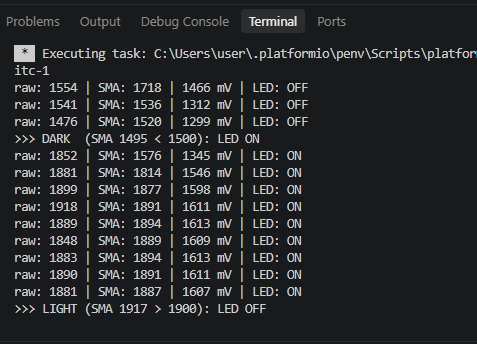

# Beetroot Academy — Embedded Development (ESP32-S3)

PlatformIO-проєкт для ESP32-S3 DevKitC-1.
У `src/` — поточне завдання, попередні — в `homework/`.

## Поточне ДЗ 3.1: Проста ковзна середня (SMA) — ESP-IDF

LDR у подільнику напруги на ADC1 ([src/main.c](src/main.c)):

- **ADC в режимі oneshot** — драйвер ESP-IDF `adc_oneshot` (`adc_oneshot_new_unit` / `adc_oneshot_read`), вимірювання кожні 20 мс (50 Гц);
- **SMA** — кільцевий буфер на 16 вимірювань і біжуча сума: нове значення додається, найстаріше віднімається;
- **LED** вмикається, коли темно, і вимикається, коли світло — за відфільтрованим значенням;
- **гістерезис**: два пороги — LED вмикається нижче `TH_DARK`, вимикається вище `TH_LIGHT`. Між порогами стан не змінюється, тому LED не мерехтить;
- у лог раз на 200 мс: сире значення, SMA, напруга в мВ (калібрування `adc_cali` curve fitting) і стан LED.

### Схема
| Елемент | Підключення |
|---|---|
| LDR (фоторезистор) | 3V3 → LDR → GPIO2 (ADC1_CH1) |
| Резистор 10 кОм | GPIO2 → 10 кОм → GND |
| LED | GPIO4 → 220 Ом → LED → GND |

### Результат (Serial Monitor)
Звичайне освітлення — SMA ≈ 2450–2660, LED вимкнений:
```
raw: 2493 | SMA: 2223 | 1891 mV | LED: OFF
raw: 2639 | SMA: 2552 | 2162 mV | LED: OFF
raw: 2667 | SMA: 2642 | 2235 mV | LED: OFF
raw: 2457 | SMA: 2459 | 2086 mV | LED: OFF
```


LDR закрито пальцем, потім відкрито — робота гістерезису:
```
raw: 1541 | SMA: 1536 | 1312 mV | LED: OFF
raw: 1476 | SMA: 1520 | 1299 mV | LED: OFF
>>> DARK  (SMA 1495 < 1500): LED ON
raw: 1852 | SMA: 1576 | 1345 mV | LED: ON
raw: 1899 | SMA: 1877 | 1598 mV | LED: ON
raw: 1918 | SMA: 1891 | 1611 mV | LED: ON
raw: 1889 | SMA: 1894 | 1613 mV | LED: ON
raw: 1848 | SMA: 1889 | 1609 mV | LED: ON
raw: 1890 | SMA: 1891 | 1611 mV | LED: ON
raw: 1881 | SMA: 1887 | 1607 mV | LED: ON
>>> LIGHT (SMA 1917 > 1900): LED OFF
```


### Висновки
- **SMA згладжує шум**: сирі значення стрибають на ±50 (напр. 1848…1918), а SMA змінюється плавно (1887…1894).
- **Гістерезис працює**: кілька секунд SMA трималось близько 1880–1894 — між порогами 1500 і 1900.
  LED залишався увімкненим і не мерехтів. З одним порогом (наприклад 1890) у цій зоні LED перемикався б постійно.
- LED вмикається, лише коли SMA < 1500, і вимикається, лише коли SMA > 1900.
## Попередні завдання (`homework/`)
- `miniproject_automotive/` — міні-проєкт (модуль 2, урок 7): замок, аварійка, поворотники, датчик удару; DL → CL → BL;
- `debounce_idf/` — ДЗ 2.6: debounce на ESP-IDF, state-based на апаратному таймері `gptimer`;
- `timers/` — ДЗ 2.5: апаратний таймер керує витяжним вентилятором (реле), watchdog, лог, LED;
- `debounce/` — ДЗ 2.4: 4 методи debounce + RC-фільтр, порівняльна таблиця;
- `superloop/` — ДЗ 2.3: три незалежні LED (200 / 500 / 1000 мс) у superloop на `millis()`;
- `relay/` — вимірювання часу спрацювання реле (`micros()` + переривання), результати 10 вимірювань;
- `motor_control/` — код з уроку: PWM-керування DC-мотором через транзистор, команди off / low / mid / high з Serial;
- `embedded_blink/` — Blink в стилі Embedded C++: `enum class`, `static constexpr`, кнопка через переривання, час `loop()`;
- `headlight_hazard/` — Варіант 2: адаптивна фара (LDR) + аварійна сигналізація, схема та симуляція Wokwi;
- `1.5_bounce.cpp` — дослідження брязкоту кнопки через переривання;
- `1.6_ldr_alt.cpp` — LDR, АЦП і похибка `analogRead()` vs `analogReadMilliVolts()`;
- `police_flasher.cpp` — поліцейська мигалка.
