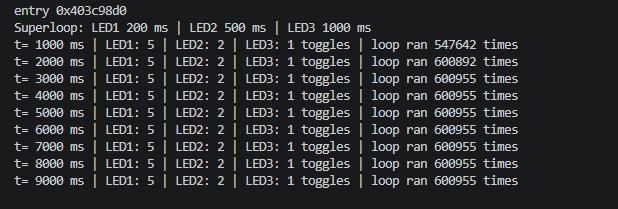

# Beetroot Academy — Embedded Development (ESP32-S3)

PlatformIO-проєкт для ESP32-S3 DevKitC-1 (Arduino framework).
У `src/` — поточне завдання, попередні — в `homework/`.

## Поточне ДЗ 2.3: Superloop та незалежні задачі

Три світлодіоди блимають незалежно в одному `loop()`:
LED1 — кожні **200 мс**, LED2 — кожні **500 мс**, LED3 — кожні **1000 мс**.

- без `delay()` і без `while` для очікування часу — тільки `millis()`;
- кожен світлодіод — об'єкт класу `BlinkingLed`, який сам знає свій пін, інтервал і час останнього перемикання;
- `loop()` на кожному проході лише питає кожен LED «чи настав твій час?» і одразу йде далі;
- раз на секунду в Serial виводиться, скільки разів перемкнувся кожен LED і скільки разів пройшов `loop()`.

### Схема
| Пін ESP | Підключення |
|---|---|
| GPIO4 | резистор 220 Ом → LED1 → GND |
| GPIO5 | резистор 220 Ом → LED2 → GND |
| GPIO6 | резистор 220 Ом → LED3 → GND |

### Результат (Serial Monitor)
```
Superloop: LED1 200 ms | LED2 500 ms | LED3 1000 ms
t= 1000 ms | LED1: 5 | LED2: 2 | LED3: 1 toggles | loop ran 547642 times
t= 2000 ms | LED1: 5 | LED2: 2 | LED3: 1 toggles | loop ran 600892 times
t= 3000 ms | LED1: 5 | LED2: 2 | LED3: 1 toggles | loop ran 600955 times
t= 4000 ms | LED1: 5 | LED2: 2 | LED3: 1 toggles | loop ran 600955 times
t= 5000 ms | LED1: 5 | LED2: 2 | LED3: 1 toggles | loop ran 600955 times
t= 6000 ms | LED1: 5 | LED2: 2 | LED3: 1 toggles | loop ran 600955 times
t= 7000 ms | LED1: 5 | LED2: 2 | LED3: 1 toggles | loop ran 600955 times
t= 8000 ms | LED1: 5 | LED2: 2 | LED3: 1 toggles | loop ran 600955 times
t= 9000 ms | LED1: 5 | LED2: 2 | LED3: 1 toggles | loop ran 600955 times
```


### Висновки
- Кожну секунду LED1 перемикається **5** разів (1000 / 200), LED2 — **2** (1000 / 500), LED3 — **1** (1000 / 1000).
  Інтервали точні і не впливають один на одного — задачі незалежні.
- `loop()` проходить близько **600 000 разів на секунду**, тобто одна ітерація ≈ **1.7 мкс**.
  Цикл ніколи не «стоїть» і встигає перевірити всі задачі сотні тисяч разів між перемиканнями.
- Перша секунда трохи менша (547 642), бо частину часу забрав старт програми і `setup()`.

## Попередні завдання (`homework/`)
- `relay/` — вимірювання часу спрацювання реле (`micros()` + переривання), результати 10 вимірювань;
- `motor_control/` — код з уроку: PWM-керування DC-мотором через транзистор, команди off / low / mid / high з Serial;
- `embedded_blink/` — Blink в стилі Embedded C++: `enum class`, `static constexpr`, кнопка через переривання, час `loop()`;
- `headlight_hazard/` — Варіант 2: адаптивна фара (LDR) + аварійна сигналізація, схема та симуляція Wokwi;
- `1.5_bounce.cpp` — дослідження брязкоту кнопки через переривання;
- `1.6_ldr_alt.cpp` — LDR, АЦП і похибка `analogRead()` vs `analogReadMilliVolts()`;
- `police_flasher.cpp` — поліцейська мигалка.
