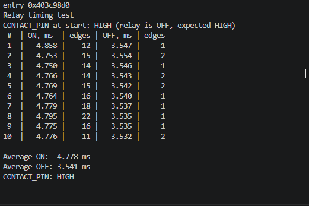

# ДЗ: вимірювання часу спрацювання реле


Реле: модуль **JQC-3F-05VDC-C** (котушка 5 В, контакти NO / COM / NC).
GPIO17 керує обмоткою реле, GPIO18 читає «сухий» контакт реле через переривання.
Програма 10 разів вмикає і вимикає реле, міряє `micros()` від команди до першого перемикання контакту,
рахує фронти брязкоту і виводить середній час увімкнення/вимкнення.

### Схема
| Звідки | Куди |
|---|---|
| ESP GPIO17 | резистор 220 Ом → база (B) 2N2222; 10 кОм від бази на GND |
| Колектор (C) 2N2222 | IN модуля реле |
| Емітер (E) 2N2222 | GND |
| Модуль реле VCC / GND | 5 В / GND від плати живлення breadboard |
| Контакт реле COM | GND ESP |
| Контакт реле NO | ESP GPIO18 (`INPUT_PULLUP`) |
| GND плати живлення | GND ESP (спільна земля) |

Чому транзистор: модуль вмикається, коли IN притиснутий до землі, а вимикається лише коли IN вільний.
3.3 В з піна ESP модуль (живлення 5 В) не вимикають, тому IN притискає до землі транзистор.
Чому окреме живлення: пін 5V цієї плати ESP32-S3 не видає 5 В назовні.

Брязкіт: ISR запам'ятовує час лише **першого** фронту, решту фронтів тільки рахує (стовпець `edges`).

### Результат (Serial Monitor)
```
Relay timing test
 #  | ON, ms  | edges | OFF, ms | edges
 1  |   4.858 |    12 |   3.547 |     1
 2  |   4.753 |    15 |   3.554 |     2
 3  |   4.750 |    14 |   3.546 |     1
 4  |   4.766 |    14 |   3.543 |     2
 5  |   4.769 |    15 |   3.542 |     2
 6  |   4.764 |    16 |   3.540 |     1
 7  |   4.779 |    18 |   3.537 |     1
 8  |   4.795 |    22 |   3.535 |     1
 9  |   4.775 |    16 |   3.535 |     1
10  |   4.776 |    11 |   3.532 |     2

Average ON:  4.778 ms
Average OFF: 3.541 ms
```


### Висновки
- Час увімкнення (замикання NO) ≈ **4.78 мс**, вимкнення (розмикання NO) ≈ **3.54 мс** — у межах даташиту JQC-3F (≤ 10 мс / ≤ 5 мс).
- Розкид між вимірюваннями — менше 0.11 мс: механіка реле дуже стабільна.
- При замиканні контакт сильно брязкотить: **11–22 фронти** за одне спрацювання. При розмиканні — 1–2 фронти.
  Тому в ISR враховується лише перший фронт, інакше час і кількість спрацювань були б хибними.
- Під час налагодження вимірювали також контакт NC: при поверненні на NC брязкіт сягав **150–200 фронтів**.

